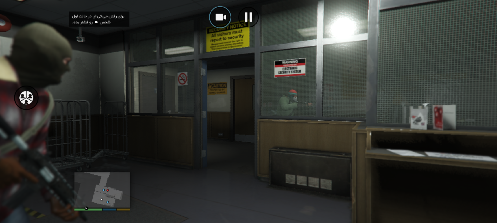
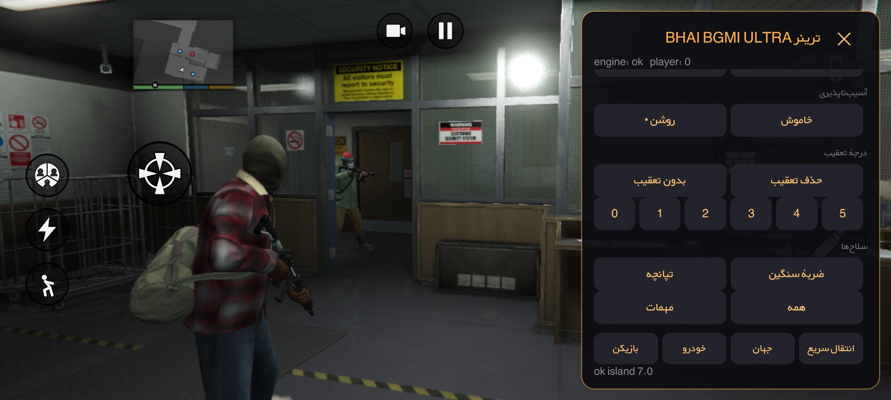

# GTA V Fuzzy — Persian localization and dubbing

**Los Santos, in Persian.**

Independent voice & text packages · Normal & Trainer editions

**AmirPhpDeveloper × mobeegame**

[فارسی](README.md) · [Downloads](https://github.com/AmirPhpDeveloper/gta-v-fuzzy-persian/releases) · [Test report](docs/TESTING.md)

Prepared by **AmirPhpDeveloper and the mobeegame team**. GameSub supplies the existing Persian game text/resources used by this project; Android UI integration, compatibility fixes and independent distribution are maintained here.

## Choose your installation

| Mode | Required downloads | Game files changed |
|---|---|---|
| Persian text/UI | `Fuzzy-Localization-fa.rar`, including normal and trainer fa APKs | `update/update.rpf`, `update/update2.rpf` |
| Persian voices only | Both `Fuzzy-Dubbing-fa.part1.rar` and `part2.rar`; keep your existing APK | 29 RPF files under `android/audio/sfx/` |
| Text and voices | Both packages plus one fa APK | Both sets above |

Archive password: **`mobeegame`**. Keep both dubbing parts together and extract part 1 using a RAR5-compatible application. Every part is below 2,000,000,000 bytes. Localization with both APKs is approximately 172 MB; dubbing totals approximately 2.37 GB. Rebuilt game files need substantially more disk space than the download.

## Installation

1. Back up your original supported game data and saves at `Android/data/com.thegwchr.fuzzy/files/userdata`. The installer requires untouched source files whose SHA-256 hashes match the manifests. Previously patched or different builds are rejected.
2. Extract the password-protected RAR. Leave the internal payload ZIPs intact. For both components, extract both packages into the same directory.
3. Install Python 3.9+ on Windows; reconstruction was tested with Python 3.11. Run `RUN-WINDOWS.cmd`, choose 1 for localization, 2 for dubbing, or 3 for both. Alternatively run `python installer/install.py` in a terminal.
4. Enter the path to the original **game** directory, then a separate output directory. The installer verifies sources, payloads and completed outputs. It never overwrites original input files. Stop on any error; do not install incomplete output.
5. Completely close the game and launcher. Copy only the generated files into the active game directory, preserving relative paths. On the test phone this was `com.thegwchr.fuzzy/files/game` at shared-storage root. Confirm your own active location.
6. For localization, install **either** `Fuzzy-Normal-fa.apk` **or** `Fuzzy-Trainer-fa.apk`. They share a package ID and cannot coexist. They share the project signing key, but differ from the original signature; first installation may require uninstalling the original. Back up saves before uninstalling.
7. Select English as the game language and enable Subtitles. Do not run a repair/import action that restores the original files after patching.

Keep your original game archive and all unrelated game files. Do not delete the entire `game` directory or savedata. These packages are patches, not a complete game download. Android/Termux installation has not been validated; the documented installer workflow runs on a computer.

## Troubleshooting

- **Wrong source version:** use clean files matching `manifests/`; already patched inputs are not supported.
- **Missing android/update/common.rpf/androida.rpf:** select the actual extracted `game` directory, not a ZIP or its parent folder.
- **English touch captions:** verify both update files are in the active location and install the corresponding fa APK. Some game strings remain outside the translation source coverage.
- **Crash/audio noise:** do not mix obsolete v9/v10 script experiments or v5 audio with this release. Report a sanitized new crash log, device model, installed variant and reproduction scene in Issues.

## Verification and scope

| Persian gameplay | Persian trainer menu |
|---|---|
|  |  |

Normal and repaired trainer APKs reached gameplay on a POCO X7 Pro running Android 15. Persian confirmation/navigation captions and trainer menus were inspected. The observed trainer native crash was traced to stale engine addresses in `libshv`; ten precise patch sites were corrected, then the menu opened in gameplay with `engine: ok` and the process remained alive. All 31 reconstructed files matched their expected SHA-256 hashes.

This is **not** a full playthrough, a listening audit of every dialogue, or validation of every trainer feature. Skip Cutscene is mapped but has not been independently exercised in a skippable scene. Voices-only with a stock APK did not receive a complete device run in this test round. See [TESTING.md](docs/TESTING.md) for exact limits.

## Development and support

Follow [MOBEE GAME on Telegram — @mobeegame](https://t.me/mobeegame) for news and releases.

See [build notes](docs/BUILD.md), [third-party notices](THIRD_PARTY_NOTICES.md), installer source and translation tables. Large deliverables live in GitHub Releases. Do not publish saves, credentials, signing keys or unredacted phone logs in bug reports. You can support the project by starring this repository.
