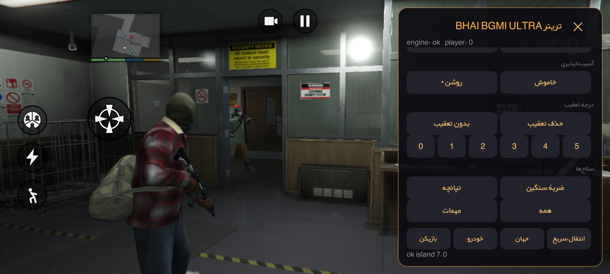

<div align="center">


# GTA V Fuzzy — فارسی‌ساز و دوبلهٔ فارسی

**لس‌سانتوس، این‌بار به فارسی**

متن فارسی • دوبلهٔ مستقل • نسخهٔ عادی و ترینر

[](https://github.com/AmirPhpDeveloper/gta-v-fuzzy-persian/releases/download/v1.0.0-fa/Fuzzy-Subtitles-2Updates-fa.rar)
[](https://t.me/mobeegame)
[](README.md)

**AmirPhpDeveloper × mobeegame**

</div>

[English guide](README.md) · [دانلودها / Downloads](https://github.com/AmirPhpDeveloper/gta-v-fuzzy-persian/releases) · [آموزش کامل نصب](README-INSTALL-FA.txt) · [گزارش بررسی](docs/TESTING.md)

فارسی‌سازی توسط **AmirPhpDeveloper و تیم mobeegame**. این پروژه، فارسی‌ساز متن و دوبله را جدا ارائه می‌کند تا بتوانید یکی یا هر دو را نصب کنید. متن و منابع فارسی داخل بازی از بستهٔ GameSub مورد استفاده در این پروژه آمده‌اند؛ اصلاح پورت اندروید و بسته‌بندی مستقل در این مخزن انجام شده است.

## انتخاب بسته

**[دانلود مستقیم زیرنویس — فقط update.rpf و update2.rpf](https://github.com/AmirPhpDeveloper/gta-v-fuzzy-persian/releases/download/v1.0.0-fa/Fuzzy-Subtitles-2Updates-fa.rar)** · [APK عادی fa](https://github.com/AmirPhpDeveloper/gta-v-fuzzy-persian/releases/download/v1.0.0-fa/Fuzzy-Normal-fa.apk) · [APK ترینر fa](https://github.com/AmirPhpDeveloper/gta-v-fuzzy-persian/releases/download/v1.0.0-fa/Fuzzy-Trainer-fa.apk)

برای اشتباه‌نشدن با بستهٔ قبلی، نام فایل زیرنویس **`Fuzzy-Subtitles-2Updates-fa.rar`** است. گزینه‌های خودکار **Source code (zip/tar.gz)** گیت‌هاب حاوی کد و ابزارهای پروژه‌اند؛ برای نصب زیرنویس، لینک مستقیم بالا را بزنید.

| حالت | دانلود و نصب | فایل دیتای تغییرکرده |
|---|---|---|
| فقط فارسی‌ساز | `Fuzzy-Subtitles-2Updates-fa.rar`، سپس یکی از APKهای عادی یا ترینر fa | `update/update.rpf` و `update/update2.rpf` |
| فقط دوبله | هر پنج پارت `Fuzzy-Dubbing-SFX-Complete-fa.part*.rar`؛ APK فعلی کافی است | کل پوشهٔ `sfx/` با هر ۵۴ فایل RPF |
| فارسی‌ساز و دوبله | هر دو بسته و یکی از APKهای fa | مجموع دو ردیف بالا |

**رمز همهٔ RARها: `mobeegame`**. RAR فارسی‌ساز حدود **۱٫۱۴ گیگابایت** است و **فقط دو فایل آمادهٔ update** دارد؛ APK، پایتون و نصاب داخل آن نیست. APKها جداگانه دانلود می‌شوند. هر پنج پارت دوبله را کنار هم بگذارید و پارت اول را استخراج کنید. هر پارت کمتر از ۲٬۰۰۰٬۰۰۰٬۰۰۰ بایت است. حجم کل دانلود **۹٫۱۲ گیگابایت** و حجم پوشه پس از استخراج **۱۰٫۰۱ گیگابایت** است.

**دانلود دوبله با SFX کامل:** [پارت 1](https://github.com/AmirPhpDeveloper/gta-v-fuzzy-persian/releases/download/v1.0.0-fa/Fuzzy-Dubbing-SFX-Complete-fa.part1.rar) · [پارت 2](https://github.com/AmirPhpDeveloper/gta-v-fuzzy-persian/releases/download/v1.0.0-fa/Fuzzy-Dubbing-SFX-Complete-fa.part2.rar) · [پارت 3](https://github.com/AmirPhpDeveloper/gta-v-fuzzy-persian/releases/download/v1.0.0-fa/Fuzzy-Dubbing-SFX-Complete-fa.part3.rar) · [پارت 4](https://github.com/AmirPhpDeveloper/gta-v-fuzzy-persian/releases/download/v1.0.0-fa/Fuzzy-Dubbing-SFX-Complete-fa.part4.rar) · [پارت 5](https://github.com/AmirPhpDeveloper/gta-v-fuzzy-persian/releases/download/v1.0.0-fa/Fuzzy-Dubbing-SFX-Complete-fa.part5.rar)

## نصب در چند مرحله

### فارسی‌ساز و زیرنویس — کپی مستقیم

1. از دو فایل update اصلی و سیو `Android/data/com.thegwchr.fuzzy/files/userdata` بکاپ بگیرید. بازی و لانچر را کامل ببندید.
2. `Fuzzy-Subtitles-2Updates-fa.rar` را با رمز `mobeegame` استخراج کنید. دقیقاً این دو فایل داخل آن است:

   ```text
   update/update.rpf
   update/update2.rpf
   ```

3. دو فایل را در پوشهٔ فعال **`game/update/`** جایگزین کنید. در گوشی تست مسیر کامل در ریشهٔ حافظه `com.thegwchr.fuzzy/files/game/update` بود. پوشهٔ تو‌در‌توی `update/update/` نسازید و کل پوشهٔ بازی را حذف نکنید. **برای این RAR فارسی‌ساز، پایتون و کامپیوتر لازم نیست.**
4. جداگانه **یکی** از `Fuzzy-Normal-fa.apk` یا `Fuzzy-Trainer-fa.apk` را دانلود و نصب کنید. این دو هم‌زمان نصب نمی‌شوند. نصب اول نسبت به APK اصلی ممکن است به‌علت امضای متفاوت حذف نسخهٔ قبلی بخواهد؛ اول سیو را ذخیره کنید.
5. زبان بازی English و Subtitles روشن باشد. بعد از پچ Repair/Import نزنید.

### دوبله — پوشهٔ کامل SFX، کپی مستقیم

1. **هر پنج پارت** `Fuzzy-Dubbing-SFX-Complete-fa.part*.rar` را در یک پوشه قرار دهید و **پارت اول** را با رمز `mobeegame` استخراج کنید.
2. داخل RAR فقط پوشهٔ `sfx` با **تمام ۵۴ فایل RPF** است: ۲۹ فایل دوبله‌شده و ۲۵ فایل اصلیِ دیگر که برای کامل‌بودن پوشه حفظ شده‌اند. نصاب، پایتون، APK یا قطعات `.header` و `.tail` داخل آن نیست.
3. بازی و لانچر را کامل ببندید. از SFX قبلی بکاپ بگیرید یا موقتاً تغییرنام بدهید؛ سپس پوشهٔ کامل `sfx` استخراج‌شده را جایگزین `game/android/audio/sfx/` کنید. مسیر گوشی تست: `/sdcard/com.thegwchr.fuzzy/files/game/android/audio/sfx/`. پوشهٔ تو‌در‌توی `sfx/sfx/` نسازید.
4. پس از نصب Repair/Import نزنید. دوبله مستقل از فارسی‌ساز است و APK تغییریافته لازم ندارد. برای داشتن متن فارسی هم بخش فارسی‌ساز بالا را انجام دهید.

بستهٔ قدیمیِ دوپارتی `Fuzzy-Dubbing-fa` **نصاب‌دار** است و فایل آمادهٔ جایگزینی ندارد. استخراج ZIPهای داخل آن قطعات `.rpf.header` و `.rpf.tail` می‌سازد؛ بازی این قطعات را نمی‌خواند. برای نصب مستقیم، پنج پارت جدیدِ SFX کامل را بگیرید.

آرشیو اصلی بازی و سیو را حفظ کنید. فقط پوشهٔ SFX جایگزین می‌شود؛ پوشه‌های دیگر بازی را پاک نکنید.

## نتیجهٔ تست و محدودیت‌ها

| داخل بازی | منوی فارسی ترینر |
|---|---|
|  |  |

نسخهٔ عادی و ترینر اصلاح‌شده روی POCO X7 Pro با Android 15 وارد گیم‌پلی شدند. دکمه‌های فارسی، منو و پنجرهٔ معرفی بررسی شدند. کرش بومیِ مشاهده‌شدهٔ ترینر از آدرس‌های قدیمی `libshv` بود؛ اصلاح آن روی همین بیلد انجام و بازشدن منو با `engine: ok` تأیید شد. بازسازی هر ۳۱ فایل با هش نهاییِ صحیح بررسی شد.

این نتیجه به معنی اجرای تمام مأموریت‌ها، شنیدن تمام دیالوگ‌ها یا آزمودن همهٔ قابلیت‌های ترینر نیست. دکمهٔ Skip Cutscene در مسیر ترجمه پوشش دارد، اما در صحنهٔ قابل‌ردکردن مستقلاً تأیید نشده است. سناریوی فقط دوبله با APK خام در این دور، اجرای کامل روی گوشی نداشت. [جزئیات و شواهد](docs/TESTING.md).

## مشارکت و حمایت

### تشکر ویژه

- از **[گیم‌ساب — GameSub](https://gamesub.net/)** برای آماده‌سازی زیرنویس و ترجمهٔ فارسی بازی.
- از **[گیم‌داب — GameDub](https://gamedub.net/)** برای آماده‌سازی دوبلهٔ فارسی و زحمات تیم دوبلاژ.

اعتبار ترجمه و دوبله متعلق به سازندگان اصلی آن‌هاست. کار این پروژه، سازگارکردن با اندروید، رفع مشکلات پورت و بسته‌بندی پچ‌های مستقل است.

برای خبرها و انتشارها به [کانال تلگرام موبی‌گیم — @mobeegame](https://t.me/mobeegame) بپیوندید.

برای گزارش اشکال، نام APK، مؤلفه‌های نصب‌شده، صحنه، مدل گوشی و گزارش کرشِ پاک‌سازی‌شده از اطلاعات شخصی را در [Issues](https://github.com/AmirPhpDeveloper/gta-v-fuzzy-persian/issues) بگذارید. سیو، اطلاعات حساب یا کلید امضا را عمومی ارسال نکنید. برای حمایت از پروژه، مخزن را **استار کنید**.

کد نصاب و ابزارهای تغییرات در مخزن قرار دارد؛ فایل‌های حجیم در Releases هستند. [روش ساخت](docs/BUILD.md) و [اعتبار منابع](THIRD_PARTY_NOTICES.md) را ببینید. این پروژه مستقل از سازندگان و ناشران بازی است.
