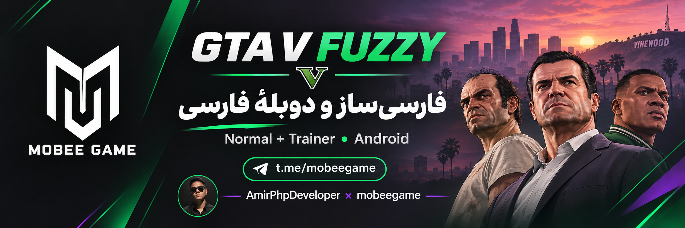

# GTA V Fuzzy — فارسی‌ساز و دوبلهٔ فارسی

**لس‌سانتوس، این‌بار به فارسی**

متن فارسی • دوبلهٔ مستقل • نسخهٔ عادی و ترینر

**AmirPhpDeveloper × mobeegame**

[English guide](README.md) · [دانلودها / Downloads](https://github.com/AmirPhpDeveloper/gta-v-fuzzy-persian/releases) · [آموزش کامل نصب](README-INSTALL-FA.txt) · [گزارش بررسی](docs/TESTING.md)

فارسی‌سازی توسط **AmirPhpDeveloper و تیم mobeegame**. این پروژه، فارسی‌ساز متن و دوبله را جدا ارائه می‌کند تا بتوانید یکی یا هر دو را نصب کنید. متن و منابع فارسی داخل بازی از بستهٔ GameSub مورد استفاده در این پروژه آمده‌اند؛ اصلاح پورت اندروید و بسته‌بندی مستقل در این مخزن انجام شده است.

## انتخاب بسته

| حالت | دانلود و نصب | فایل دیتای تغییرکرده |
|---|---|---|
| فقط فارسی‌ساز | `Fuzzy-Localization-fa.rar`، سپس یکی از APKهای عادی یا ترینر fa | `update/update.rpf` و `update/update2.rpf` |
| فقط دوبله | هر دو پارت `Fuzzy-Dubbing-fa.part1.rar` و `part2.rar`؛ APK فعلی کافی است | ۲۹ فایل در `android/audio/sfx/` |
| فارسی‌ساز و دوبله | هر دو بسته و یکی از APKهای fa | مجموع دو ردیف بالا |

**رمز همهٔ RARها: `mobeegame`**. پارت‌های دوبله را کنار هم بگذارید و فقط پارت اول را استخراج کنید. هر پارت کمتر از ۲٬۰۰۰٬۰۰۰٬۰۰۰ بایت است. فارسی‌ساز همراه دو APK حدود ۱۷۲ مگابایت و مجموع دوبله حدود ۲٫۳۷ گیگابایت است. حجم فایل بازسازی‌شده روی دیسک بیشتر از حجم دانلود است.

## نصب در چند مرحله

1. از دیتای اصلی همان بیلد و پوشهٔ سیو `Android/data/com.thegwchr.fuzzy/files/userdata` بکاپ داشته باشید. پچ ورودیِ دست‌نخورده می‌خواهد؛ روی فایل قبلاً پچ‌شده اعمال نمی‌شود.
2. RAR مربوط را با رمز بالا استخراج کنید. ZIPهای داخل بسته، ورودی نصاب‌اند؛ آن‌ها را باز نکنید. برای نصب هر دو مؤلفه، محتویات هر دو بسته را در یک پوشه استخراج کنید.
3. روی ویندوز Python 3.9 یا جدیدتر نصب کنید؛ آزمون بازسازی با Python 3.11 انجام شده است. `RUN-WINDOWS.cmd` را اجرا کنید. گزینهٔ ۱ فارسی‌ساز، ۲ دوبله و ۳ هر دو است.
4. مسیر **خود پوشهٔ game اصلی** و یک پوشهٔ خروجی جداگانه را وارد کنید. نصاب منبع را تغییر نمی‌دهد؛ نسخه و هش ورودی، دادهٔ پچ و هش خروجی را کنترل می‌کند. در خطا توقف کنید و فایل ناقص را نصب نکنید.
5. بازی و لانچر را کاملاً ببندید. فقط فایل‌های ساخته‌شده در خروجی را با حفظ مسیرشان در پوشهٔ فعال game کپی و جایگزین کنید. در این گوشی مسیر فعال `com.thegwchr.fuzzy/files/game` در ریشهٔ حافظه بود؛ مسیر گوشی خودتان را بررسی کنید.
6. برای فارسی‌ساز، **فقط یکی** از `Fuzzy-Normal-fa.apk` یا `Fuzzy-Trainer-fa.apk` را نصب کنید. هر دو یک شناسهٔ برنامه دارند و هم‌زمان نصب نمی‌شوند. امضای fa با نسخهٔ اصلی متفاوت است؛ نصب اول ممکن است حذف نسخهٔ قبلی بخواهد، پس ابتدا سیو را ذخیره کنید.
7. زبان بازی را English و گزینهٔ Subtitles را روشن کنید. پس از پچ، عملیات Repair/Import که دیتا را بازنویسی می‌کند انجام ندهید.

**کل پوشهٔ game، فایل‌های اصلی بازی و سیو را حذف نکنید.** راهنمای مفصل خطاها و روش دستی در [آموزش نصب](README-INSTALL-FA.txt) آمده است. این بسته جایگزین دانلود دیتای اصلی بازی نیست و فقط برای هش‌های ثبت‌شده در `manifests/` ساخته شده است.

## نتیجهٔ تست و محدودیت‌ها

| داخل بازی | منوی فارسی ترینر |
|---|---|
|  |  |

نسخهٔ عادی و ترینر اصلاح‌شده روی POCO X7 Pro با Android 15 وارد گیم‌پلی شدند. دکمه‌های فارسی، منو و پنجرهٔ معرفی بررسی شدند. کرش بومیِ مشاهده‌شدهٔ ترینر از آدرس‌های قدیمی `libshv` بود؛ اصلاح آن روی همین بیلد انجام و بازشدن منو با `engine: ok` تأیید شد. بازسازی هر ۳۱ فایل با هش نهاییِ صحیح بررسی شد.

این نتیجه به معنی اجرای تمام مأموریت‌ها، شنیدن تمام دیالوگ‌ها یا آزمودن همهٔ قابلیت‌های ترینر نیست. دکمهٔ Skip Cutscene در مسیر ترجمه پوشش دارد، اما در صحنهٔ قابل‌ردکردن مستقلاً تأیید نشده است. سناریوی فقط دوبله با APK خام در این دور، اجرای کامل روی گوشی نداشت. [جزئیات و شواهد](docs/TESTING.md).

## مشارکت و حمایت

### تشکر ویژه

- از **[گیم‌ساب — GameSub](https://gamesub.net/)** برای آماده‌سازی زیرنویس و ترجمهٔ فارسی بازی.
- از **[گیم‌داب — GameDub](https://gamedub.net/)** برای آماده‌سازی دوبلهٔ فارسی و زحمات تیم دوبلاژ.

اعتبار ترجمه و دوبله متعلق به سازندگان اصلی آن‌هاست. کار این پروژه، سازگارکردن با اندروید، رفع مشکلات پورت و بسته‌بندی پچ‌های مستقل است.

برای خبرها و انتشارها به [کانال تلگرام موبی‌گیم — @mobeegame](https://t.me/mobeegame) بپیوندید.

برای گزارش اشکال، نام APK، مؤلفه‌های نصب‌شده، صحنه، مدل گوشی و گزارش کرشِ پاک‌سازی‌شده از اطلاعات شخصی را در [Issues](https://github.com/AmirPhpDeveloper/gta-v-fuzzy-persian/issues) بگذارید. سیو، اطلاعات حساب یا کلید امضا را عمومی ارسال نکنید. برای حمایت از پروژه، مخزن را **استار کنید**.

کد نصاب و ابزارهای تغییرات در مخزن قرار دارد؛ فایل‌های حجیم در Releases هستند. [روش ساخت](docs/BUILD.md) و [اعتبار منابع](THIRD_PARTY_NOTICES.md) را ببینید. این پروژه مستقل از سازندگان و ناشران بازی است.
