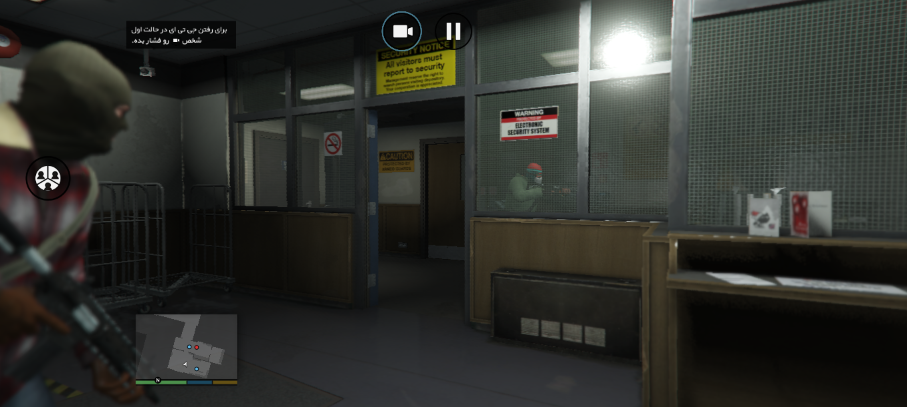

<div align="center">


# GTA V Fuzzy — فارسی‌ساز و دوبلهٔ فارسی

**لس‌سانتوس، این‌بار به فارسی**

متن فارسی • دوبلهٔ مستقل • نسخهٔ عادی و ترینر

[](https://github.com/AmirPhpDeveloper/gta-v-fuzzy-persian/releases/latest)
[](https://t.me/mobeegame)
[](README.md)

**AmirPhpDeveloper × mobeegame**

</div>

[English guide](README.md) · [دانلودها / Downloads](https://github.com/AmirPhpDeveloper/gta-v-fuzzy-persian/releases) · [آموزش کامل نصب](README-INSTALL-FA.txt) · [گزارش بررسی](docs/TESTING.md)

فارسی‌سازی توسط **AmirPhpDeveloper و تیم mobeegame**. این پروژه، فارسی‌ساز متن و دوبله را جدا ارائه می‌کند تا بتوانید یکی یا هر دو را نصب کنید. متن و منابع فارسی داخل بازی از بستهٔ GameSub مورد استفاده در این پروژه آمده‌اند؛ اصلاح پورت اندروید و بسته‌بندی مستقل در این مخزن انجام شده است.

## انتخاب بسته

| حالت | دانلود و نصب | فایل دیتای تغییرکرده |
|---|---|---|
| فقط فارسی‌ساز | `Fuzzy-Localization-fa.rar`، سپس یکی از APKهای عادی یا ترینر fa | `update/update.rpf` و `update/update2.rpf` |
| فقط دوبله | هر دو پارت `Fuzzy-Dubbing-fa.part1.rar` و `part2.rar`؛ APK فعلی کافی است | ۲۹ فایل در `android/audio/sfx/` |
| فارسی‌ساز و دوبله | هر دو بسته و یکی از APKهای fa | مجموع دو ردیف بالا |

**رمز همهٔ RARها: `mobeegame`**. RAR فارسی‌ساز حدود **۱٫۱۴ گیگابایت** است و **فقط دو فایل آمادهٔ update** دارد؛ APK، پایتون و نصاب داخل آن نیست. APKها جداگانه دانلود می‌شوند. پارت‌های دوبله را کنار هم بگذارید و فقط پارت اول را استخراج کنید. هر پارت کمتر از ۲٬۰۰۰٬۰۰۰٬۰۰۰ بایت است. دوبله حدود ۲٫۳۷ گیگابایت است و روش کم‌حجمِ بازسازی زیر را دارد.

## نصب در چند مرحله

### فارسی‌ساز و زیرنویس — کپی مستقیم

1. از دو فایل update اصلی و سیو `Android/data/com.thegwchr.fuzzy/files/userdata` بکاپ بگیرید. بازی و لانچر را کامل ببندید.
2. `Fuzzy-Localization-fa.rar` را با رمز `mobeegame` استخراج کنید. دقیقاً این دو فایل داخل آن است:

   ```text
   update/update.rpf
   update/update2.rpf
   ```

3. دو فایل را در پوشهٔ فعال **`game/update/`** جایگزین کنید. در گوشی تست مسیر کامل در ریشهٔ حافظه `com.thegwchr.fuzzy/files/game/update` بود. پوشهٔ تو‌در‌توی `update/update/` نسازید و کل پوشهٔ بازی را حذف نکنید. **برای این RAR فارسی‌ساز، پایتون و کامپیوتر لازم نیست.**
4. جداگانه **یکی** از `Fuzzy-Normal-fa.apk` یا `Fuzzy-Trainer-fa.apk` را دانلود و نصب کنید. این دو هم‌زمان نصب نمی‌شوند. نصب اول نسبت به APK اصلی ممکن است به‌علت امضای متفاوت حذف نسخهٔ قبلی بخواهد؛ اول سیو را ذخیره کنید.
5. زبان بازی English و Subtitles روشن باشد. بعد از پچ Repair/Import نزنید.

### دوبله — بستهٔ کم‌حجم

1. هر دو پارت RAR دوبله را کنار هم بگذارید و پارت اول را استخراج کنید. ZIPهای داخلی را باز نکنید.
2. روی کامپیوتر با Python 3.9 یا جدیدتر `RUN-WINDOWS.cmd` را اجرا و **گزینهٔ ۲، دوبله** را انتخاب کنید. فارسی‌ساز فعلی با روش دستی بالا نصب می‌شود؛ برای آن گزینهٔ ۱ یا ۳ را نزنید.
3. مسیر `game` اصلیِ دست‌نخورده و یک خروجی جدا بدهید؛ هش‌ها کنترل می‌شوند. خروجی خطادار را نصب نکنید.
4. بازی بسته باشد؛ ۲۹ فایل صوتی ساخته‌شده را با حفظ مسیر در `game/android/audio/sfx/` جایگزین کنید. دوبلهٔ تنها به APK تغییریافته نیاز ندارد.

برای داشتن هر دو، هر دو روش مستقل بالا را انجام دهید. دوبله دو فایل update را بازنویسی نمی‌کند. راهنمای داخل آرشیوهای قدیمی دوبله ممکن است روش بستهٔ کم‌حجم قبلیِ متن را توضیح دهد؛ برای فارسی‌ساز، همین آموزش جدید ملاک است.

**کل پوشهٔ game، فایل‌های اصلی بازی و سیو را حذف نکنید.** راهنمای مفصل خطاها و روش دستی در [آموزش نصب](README-INSTALL-FA.txt) آمده است. این بسته جایگزین دانلود دیتای اصلی بازی نیست و فقط برای هش‌های ثبت‌شده در `manifests/` ساخته شده است.

## نتیجهٔ تست و محدودیت‌ها

| داخل بازی | منوی فارسی ترینر |
|---|---|
|  |  |

نسخهٔ عادی و ترینر اصلاح‌شده روی POCO X7 Pro با Android 15 وارد گیم‌پلی شدند. دکمه‌های فارسی، منو و پنجرهٔ معرفی بررسی شدند. کرش بومیِ مشاهده‌شدهٔ ترینر از آدرس‌های قدیمی `libshv` بود؛ اصلاح آن روی همین بیلد انجام و بازشدن منو با `engine: ok` تأیید شد. بازسازی هر ۳۱ فایل با هش نهاییِ صحیح بررسی شد.

این نتیجه به معنی اجرای تمام مأموریت‌ها، شنیدن تمام دیالوگ‌ها یا آزمودن همهٔ قابلیت‌های ترینر نیست. دکمهٔ Skip Cutscene در مسیر ترجمه پوشش دارد، اما در صحنهٔ قابل‌ردکردن مستقلاً تأیید نشده است. سناریوی فقط دوبله با APK خام در این دور، اجرای کامل روی گوشی نداشت. [جزئیات و شواهد](docs/TESTING.md).

## مشارکت و حمایت

### تشکر ویژه

- از **[گیم‌ساب — GameSub](https://gamesub.net/)** برای آماده‌سازی زیرنویس و ترجمهٔ فارسی بازی.
- از **[گیم‌داب — GameDub](https://gamedub.net/)** برای آماده‌سازی دوبلهٔ فارسی و زحمات تیم دوبلاژ.

اعتبار ترجمه و دوبله متعلق به سازندگان اصلی آن‌هاست. کار این پروژه، سازگارکردن با اندروید، رفع مشکلات پورت و بسته‌بندی پچ‌های مستقل است.

برای خبرها و انتشارها به [کانال تلگرام موبی‌گیم — @mobeegame](https://t.me/mobeegame) بپیوندید.

برای گزارش اشکال، نام APK، مؤلفه‌های نصب‌شده، صحنه، مدل گوشی و گزارش کرشِ پاک‌سازی‌شده از اطلاعات شخصی را در [Issues](https://github.com/AmirPhpDeveloper/gta-v-fuzzy-persian/issues) بگذارید. سیو، اطلاعات حساب یا کلید امضا را عمومی ارسال نکنید. برای حمایت از پروژه، مخزن را **استار کنید**.

کد نصاب و ابزارهای تغییرات در مخزن قرار دارد؛ فایل‌های حجیم در Releases هستند. [روش ساخت](docs/BUILD.md) و [اعتبار منابع](THIRD_PARTY_NOTICES.md) را ببینید. این پروژه مستقل از سازندگان و ناشران بازی است.
