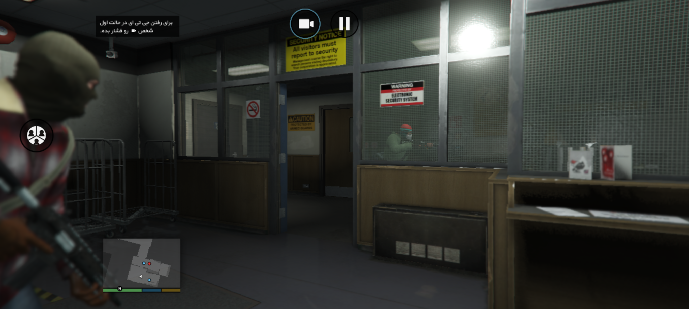
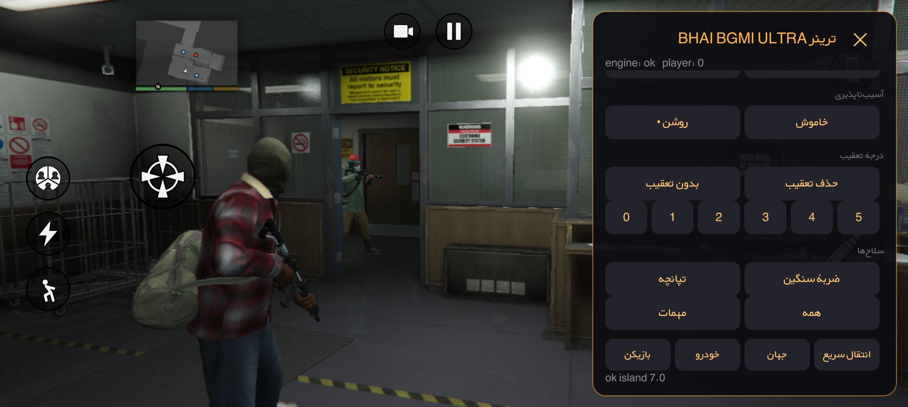

<div align="center">


# GTA V Fuzzy — Persian localization and dubbing

**Los Santos, in Persian.**

Independent voice & text packages · Normal & Trainer editions

[](https://github.com/AmirPhpDeveloper/gta-v-fuzzy-persian/releases/download/v1.0.0-fa/Fuzzy-Subtitles-2Updates-fa.rar)
[](https://t.me/mobeegame)
[](README.fa.md)

**AmirPhpDeveloper × mobeegame**

</div>

[فارسی](README.fa.md) · [Downloads](https://github.com/AmirPhpDeveloper/gta-v-fuzzy-persian/releases) · [Test report](docs/TESTING.md)

Prepared by **AmirPhpDeveloper and the mobeegame team**. GameSub supplies the existing Persian game text/resources used by this project; Android UI integration, compatibility fixes and independent distribution are maintained here.

## Choose your installation

**[Download subtitles — only update.rpf + update2.rpf](https://github.com/AmirPhpDeveloper/gta-v-fuzzy-persian/releases/download/v1.0.0-fa/Fuzzy-Subtitles-2Updates-fa.rar)** · [Normal fa APK](https://github.com/AmirPhpDeveloper/gta-v-fuzzy-persian/releases/download/v1.0.0-fa/Fuzzy-Normal-fa.apk) · [Trainer fa APK](https://github.com/AmirPhpDeveloper/gta-v-fuzzy-persian/releases/download/v1.0.0-fa/Fuzzy-Trainer-fa.apk)

The subtitles archive is named **`Fuzzy-Subtitles-2Updates-fa.rar`** to distinguish it from the old compact package. GitHub's automatic **Source code (zip/tar.gz)** downloads contain project tools, not the ready-to-copy subtitles package. Use the direct subtitle link above.

| Mode | Required downloads | Game files changed |
|---|---|---|
| Persian text/UI | `Fuzzy-Subtitles-2Updates-fa.rar` plus one separately downloaded fa APK | `update/update.rpf`, `update/update2.rpf` |
| Persian voices only | All five `Fuzzy-Dubbing-SFX-Complete-fa.part*.rar` volumes; keep your existing APK | Complete `sfx/` folder, all 54 RPF files |
| Text and voices | Both packages plus one fa APK | Both sets above |

Archive password: **`mobeegame`**. The localization RAR is approximately **1.14 GB** and contains **only the two ready-to-copy update RPF files**; no APK, Python scripts or installer. APKs are separate downloads. Keep all five dubbing volumes together and extract part 1. Each volume is below 2,000,000,000 bytes. The full SFX download totals **9.12 GB**, with **10.01 GB** required after extraction.

**Complete SFX dubbing:** [Part 1](https://github.com/AmirPhpDeveloper/gta-v-fuzzy-persian/releases/download/v1.0.0-fa/Fuzzy-Dubbing-SFX-Complete-fa.part1.rar) · [Part 2](https://github.com/AmirPhpDeveloper/gta-v-fuzzy-persian/releases/download/v1.0.0-fa/Fuzzy-Dubbing-SFX-Complete-fa.part2.rar) · [Part 3](https://github.com/AmirPhpDeveloper/gta-v-fuzzy-persian/releases/download/v1.0.0-fa/Fuzzy-Dubbing-SFX-Complete-fa.part3.rar) · [Part 4](https://github.com/AmirPhpDeveloper/gta-v-fuzzy-persian/releases/download/v1.0.0-fa/Fuzzy-Dubbing-SFX-Complete-fa.part4.rar) · [Part 5](https://github.com/AmirPhpDeveloper/gta-v-fuzzy-persian/releases/download/v1.0.0-fa/Fuzzy-Dubbing-SFX-Complete-fa.part5.rar)

## Installation

### Persian text and subtitles — direct copy

1. Back up the original update files and saves at `Android/data/com.thegwchr.fuzzy/files/userdata`. Completely close the game and launcher.
2. Extract `Fuzzy-Subtitles-2Updates-fa.rar` with password `mobeegame`. It contains exactly:

   ```text
   update/update.rpf
   update/update2.rpf
   ```

3. Copy those two files into the **active `game/update/` directory**, replacing the matching files. On the test phone the full path was `com.thegwchr.fuzzy/files/game/update` at shared-storage root. Do not create `update/update/` or replace/delete the whole game folder. **No Python or computer is required for this localization archive.**
4. Separately download and install **either** `Fuzzy-Normal-fa.apk` **or** `Fuzzy-Trainer-fa.apk`. They share a package ID and cannot coexist. First installation may require uninstalling an original APK with a different signature; back up saves first.
5. Select English as the game language and enable Subtitles. Do not run repair/import afterward.

### Dubbing — complete SFX folder, direct copy

1. Download **all five** `Fuzzy-Dubbing-SFX-Complete-fa.part*.rar` volumes into one folder and extract **part 1** with password `mobeegame`.
2. The archive contains only `sfx/` with **all 54 RPF files**: 29 dubbed archives plus 25 unchanged originals required for a complete folder. No installer, Python, APK or `.header`/`.tail` fragments are included.
3. Completely close the game and launcher. Keep a backup of the previous SFX folder, then replace the entire active `game/android/audio/sfx/` folder with the extracted `sfx/`. On the test phone the destination is `/sdcard/com.thegwchr.fuzzy/files/game/android/audio/sfx/`. Avoid nesting `sfx/sfx/`.
4. Do not run Repair/Import afterward. Dubbing works independently of localization and requires no modified APK. To install both components, also follow the text/subtitle procedure above.

The earlier two-part `Fuzzy-Dubbing-fa` download is a **legacy installer package**, not ready-to-copy SFX. Extracting its payload ZIPs produces `.rpf.header` and `.rpf.tail` fragments which the game cannot read. Use the five complete-SFX volumes above for direct installation.

Keep the original game archive and saves. Only the SFX folder is supplied in this dubbing package; do not remove other game folders.

## Troubleshooting

- **Voices remain English:** verify the complete RPF files were copied into the active SFX folder. `.header` and `.tail` files are installer fragments and do not replace RPFs. The new package contains 54 complete RPFs.
- **Missing android/update/common.rpf/androida.rpf:** select the actual extracted `game` directory, not a ZIP or its parent folder.
- **English touch captions:** verify both update files are in the active location and install the corresponding fa APK. Some game strings remain outside the translation source coverage.
- **Crash/audio noise:** do not mix obsolete v9/v10 script experiments or v5 audio with this release. Report a sanitized new crash log, device model, installed variant and reproduction scene in Issues.

## Verification and scope

| Persian gameplay | Persian trainer menu |
|---|---|
|  |  |

Normal and repaired trainer APKs reached gameplay on a POCO X7 Pro running Android 15. Persian confirmation/navigation captions and trainer menus were inspected. The observed trainer native crash was traced to stale engine addresses in `libshv`; ten precise patch sites were corrected, then the menu opened in gameplay with `engine: ok` and the process remained alive. All 31 reconstructed files matched their expected SHA-256 hashes.

This is **not** a full playthrough, a listening audit of every dialogue, or validation of every trainer feature. Skip Cutscene is mapped but has not been independently exercised in a skippable scene. Voices-only with a stock APK did not receive a complete device run in this test round. See [TESTING.md](docs/TESTING.md) for exact limits.

## Development and support

### Special thanks

- **[GameSub — gamesub.net](https://gamesub.net/)** for preparing the Persian subtitles and game translation.
- **[GameDub — gamedub.net](https://gamedub.net/)** for preparing the Persian dubbing and the work of its voice team.

Their translation and dubbing remain credited to their original creators. Our work here concerns Android integration, compatibility fixes and independent patch packaging.

Follow [MOBEE GAME on Telegram — @mobeegame](https://t.me/mobeegame) for news and releases.

See [build notes](docs/BUILD.md), [third-party notices](THIRD_PARTY_NOTICES.md), installer source and translation tables. Large deliverables live in GitHub Releases. Do not publish saves, credentials, signing keys or unredacted phone logs in bug reports. You can support the project by starring this repository.
