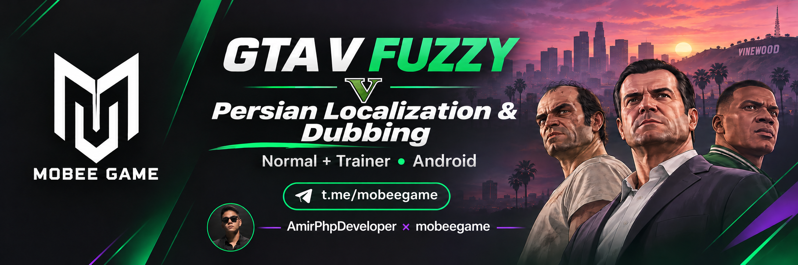

<div align="center">



# GTA V Fuzzy — Persian localization and dubbing

**Los Santos, in Persian.**

Independent voice & text packages · Normal & Trainer editions

[](https://github.com/AmirPhpDeveloper/gta-v-fuzzy-persian/releases/latest)
[](https://t.me/mobeegame)
[](README.fa.md)

**AmirPhpDeveloper × mobeegame**

</div>

[فارسی](README.fa.md) · [Downloads](https://github.com/AmirPhpDeveloper/gta-v-fuzzy-persian/releases) · [Test report](docs/TESTING.md)

Prepared by **AmirPhpDeveloper and the mobeegame team**. GameSub supplies the existing Persian game text/resources used by this project; Android UI integration, compatibility fixes and independent distribution are maintained here.

## Choose your installation

| Mode | Required downloads | Game files changed |
|---|---|---|
| Persian text/UI | `Fuzzy-Localization-fa.rar` plus one separately downloaded fa APK | `update/update.rpf`, `update/update2.rpf` |
| Persian voices only | Both `Fuzzy-Dubbing-fa.part1.rar` and `part2.rar`; keep your existing APK | 29 RPF files under `android/audio/sfx/` |
| Text and voices | Both packages plus one fa APK | Both sets above |

Archive password: **`mobeegame`**. The localization RAR is approximately **1.14 GB** and contains **only the two ready-to-copy update RPF files**; no APK, Python scripts or installer. APKs are separate downloads. Keep both dubbing parts together and extract part 1 using a RAR5-compatible application. Every part is below 2,000,000,000 bytes. Dubbing totals approximately 2.37 GB and uses the compact reconstruction workflow below.

## Installation

### Persian text and subtitles — direct copy

1. Back up the original update files and saves at `Android/data/com.thegwchr.fuzzy/files/userdata`. Completely close the game and launcher.
2. Extract `Fuzzy-Localization-fa.rar` with password `mobeegame`. It contains exactly:

   ```text
   update/update.rpf
   update/update2.rpf
   ```

3. Copy those two files into the **active `game/update/` directory**, replacing the matching files. On the test phone the full path was `com.thegwchr.fuzzy/files/game/update` at shared-storage root. Do not create `update/update/` or replace/delete the whole game folder. **No Python or computer is required for this localization archive.**
4. Separately download and install **either** `Fuzzy-Normal-fa.apk` **or** `Fuzzy-Trainer-fa.apk`. They share a package ID and cannot coexist. First installation may require uninstalling an original APK with a different signature; back up saves first.
5. Select English as the game language and enable Subtitles. Do not run repair/import afterward.

### Dubbing — compact package

1. Extract both dubbing RAR parts together. Leave the internal payload ZIPs intact.
2. On a computer with Python 3.9+, run `RUN-WINDOWS.cmd` and choose **2 (dubbing)**. The current direct localization RAR is installed manually above; do not choose 1 or 3 for it.
3. Supply the clean original **game** directory and a separate output directory. Supported source hashes are checked. Do not install output if verification fails.
4. With the game closed, copy the generated 29 audio RPF files into the matching `game/android/audio/sfx/` paths. A modified APK is not required for dubbing alone.

For both text and voices, perform these two independent procedures. Dubbing does not overwrite the two update files. Installer reconstruction was tested with Python 3.11. Instructions bundled inside older dubbing archives may describe the earlier compact text package; use this current guide for localization.

Keep your original game archive and all unrelated game files. Do not delete the entire `game` directory or savedata. These packages are patches, not a complete game download. Android/Termux installation has not been validated; the documented installer workflow runs on a computer.

## Troubleshooting

- **Wrong source version:** use clean files matching `manifests/`; already patched inputs are not supported.
- **Missing android/update/common.rpf/androida.rpf:** select the actual extracted `game` directory, not a ZIP or its parent folder.
- **English touch captions:** verify both update files are in the active location and install the corresponding fa APK. Some game strings remain outside the translation source coverage.
- **Crash/audio noise:** do not mix obsolete v9/v10 script experiments or v5 audio with this release. Report a sanitized new crash log, device model, installed variant and reproduction scene in Issues.

## Verification and scope

| Persian gameplay | Persian trainer menu |
|---|---|
|  |  |

Normal and repaired trainer APKs reached gameplay on a POCO X7 Pro running Android 15. Persian confirmation/navigation captions and trainer menus were inspected. The observed trainer native crash was traced to stale engine addresses in `libshv`; ten precise patch sites were corrected, then the menu opened in gameplay with `engine: ok` and the process remained alive. All 31 reconstructed files matched their expected SHA-256 hashes.

This is **not** a full playthrough, a listening audit of every dialogue, or validation of every trainer feature. Skip Cutscene is mapped but has not been independently exercised in a skippable scene. Voices-only with a stock APK did not receive a complete device run in this test round. See [TESTING.md](docs/TESTING.md) for exact limits.

## Development and support

### Special thanks

- **[GameSub — gamesub.net](https://gamesub.net/)** for preparing the Persian subtitles and game translation.
- **[GameDub — gamedub.net](https://gamedub.net/)** for preparing the Persian dubbing and the work of its voice team.

Their translation and dubbing remain credited to their original creators. Our work here concerns Android integration, compatibility fixes and independent patch packaging.

Follow [MOBEE GAME on Telegram — @mobeegame](https://t.me/mobeegame) for news and releases.

See [build notes](docs/BUILD.md), [third-party notices](THIRD_PARTY_NOTICES.md), installer source and translation tables. Large deliverables live in GitHub Releases. Do not publish saves, credentials, signing keys or unredacted phone logs in bug reports. You can support the project by starring this repository.
